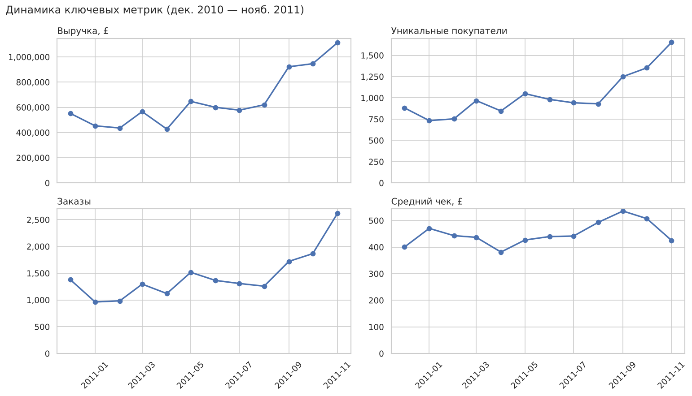
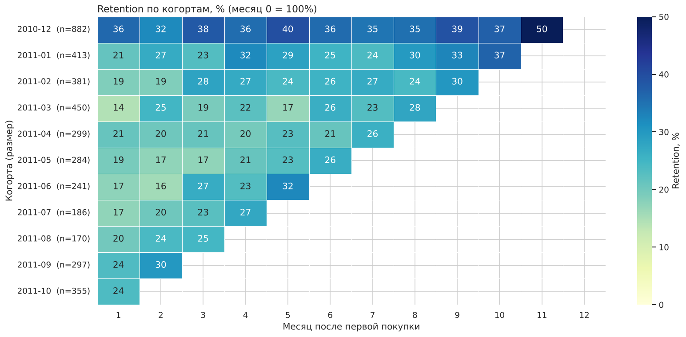
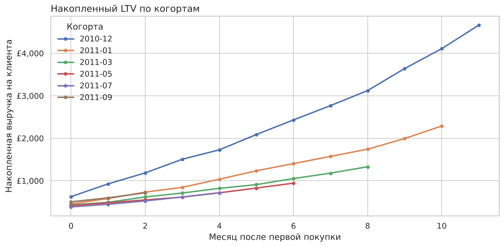
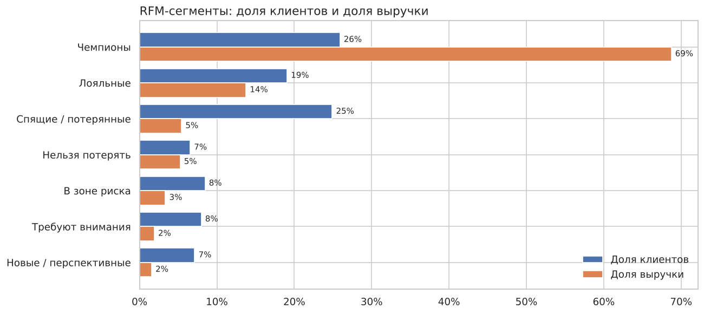

# Когортный анализ и RFM-сегментация интернет-магазина

Анализ годовых транзакций британского онлайн-ретейлера подарков: продуктовые метрики, удержание клиентов по когортам, накопленный LTV и RFM-сегментация с рекомендациями для бизнеса.

**Стек:** Python (pandas, NumPy, matplotlib, seaborn), SQL (SQLite: CTE, оконные функции), Jupyter

📓 **Основной ноутбук:** [`cohort_rfm_analysis.ipynb`](cohort_rfm_analysis.ipynb)

## Данные

[Online Retail — UCI Machine Learning Repository](https://archive.ics.uci.edu/dataset/352/online+retail): 541 909 строк чеков за 01.12.2010–09.12.2011. После очистки осталось 385 929 строк, 4 321 клиент, 18 162 заказа и £8,2 млн выручки.

При очистке удалены строки без клиента, отмены **вместе с отменёнными исходными покупками** (иначе в данных остаются «фантомные» заказы на десятки тысяч штук), служебные коды (доставка, комиссии, ручные корректировки) и дубликаты.

## Ключевые результаты

**1. Выручка удвоилась за год, рост даёт приток покупателей, а не средний чек.**
Выручка выросла на +102% (дек. 2010 → нояб. 2011), число покупателей на +87%, средний чек всего на +6%. На сентябрь–ноябрь приходится 38% годовой выручки.



**2. Главная потеря клиентов происходит сразу после первой покупки.**
Во второй месяц возвращается только ~20% новых клиентов, но дальше удержание стабильно держится на 22–25%. Когорта декабря 2010 года (32–40%) содержит накопленную базу давних клиентов, потому что данные начинаются с этой даты.



**3. За 5 месяцев повторные покупки удваивают выручку на клиента.**
Первая покупка приносит £400–450, а накопленный LTV к 5-му месяцу составляет ≈ £830–910.



**4. Выручка сильно сконцентрирована.**
26% клиентов («Чемпионы») дают 69% выручки, топ-20% клиентов дают 73%. Ещё 15% клиентов («Нельзя потерять», «В зоне риска») раньше покупали часто, но давно не возвращались.



## Рекомендации

1. **Онбординг после первой покупки** (цепочка писем, промокод на второй заказ) с целью +5 п.п. к retention 1-го месяца.
2. **Программа лояльности для «Чемпионов»** и отдельный мониторинг их оттока.
3. **Win-back кампания** для сегментов «Нельзя потерять» и «В зоне риска» (≈650 клиентов).
4. **Подготовка к сезону к августу**: склад, маркетинг, реактивация.
5. **A/B-тесты механик роста среднего чека**: наборы, порог бесплатной доставки, рекомендации.

## Структура репозитория

```
├── cohort_rfm_analysis.ipynb   # анализ с графиками и выводами
├── sql/
│   ├── 01_monthly_metrics.sql  # выручка, заказы, покупатели, средний чек по месяцам
│   ├── 02_cohort_retention.sql # когорты и retention (CTE + FIRST_VALUE)
│   ├── 03_rfm_base.sql         # recency / frequency / monetary по клиентам
│   └── 04_top_products.sql     # топ товаров и их доля в выручке (оконная функция)
├── data/online_retail.csv.gz   # исходные данные
├── images/                     # графики для README
└── requirements.txt
```

## Как запустить

```bash
pip install -r requirements.txt
jupyter notebook cohort_rfm_analysis.ipynb
```

SQL-запросы выполняются внутри ноутбука на SQLite в памяти, поэтому отдельная база не нужна.
